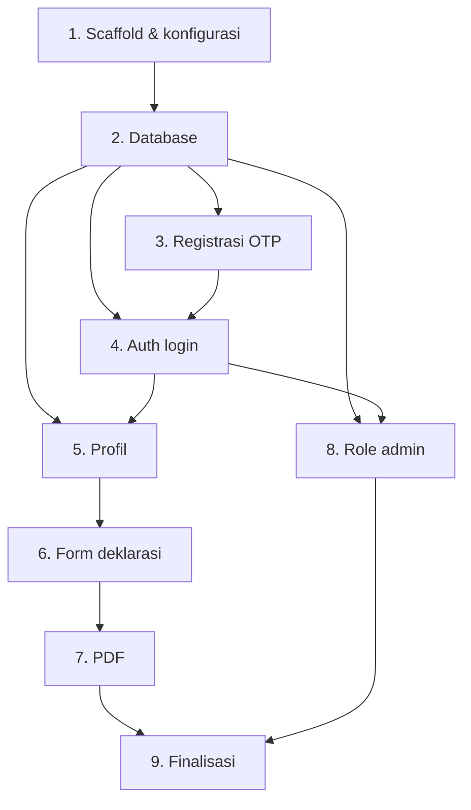

# Implementation Plan — Portal Pernyataan Potensi Benturan Kepentingan

## Overview

Rencana implementasi portal pernyataan potensi benturan kepentingan berbasis Laravel 11 (PHP 8.4), Blade + Tailwind + Alpine.js, PostgreSQL, dan PDF via Dompdf. Task disusun bertahap: scaffold → database → registrasi OTP → auth → profil → form deklarasi → PDF → admin → finalisasi. Setiap task implementasi disertai validasi server dan pengujian otomatis.

## Task Dependency Graph



```json
{
  "waves": [
    { "wave": 1, "tasks": ["1.1"] },
    { "wave": 2, "tasks": ["1.2", "1.3"] },
    { "wave": 3, "tasks": ["2.1", "2.2", "2.3", "2.4"] },
    { "wave": 4, "tasks": ["2.5"] },
    { "wave": 5, "tasks": ["3.1"] },
    { "wave": 6, "tasks": ["3.2"] },
    { "wave": 7, "tasks": ["3.3", "4.1"] },
    { "wave": 8, "tasks": ["4.2", "5.1"] },
    { "wave": 9, "tasks": ["5.2", "8.1"] },
    { "wave": 10, "tasks": ["5.3", "8.2"] },
    { "wave": 11, "tasks": ["6.1"] },
    { "wave": 12, "tasks": ["6.2", "6.3"] },
    { "wave": 13, "tasks": ["6.4", "7.1"] },
    { "wave": 14, "tasks": ["7.2"] },
    { "wave": 15, "tasks": ["7.3"] },
    { "wave": 16, "tasks": ["7.4"] },
    { "wave": 17, "tasks": ["9.1", "9.2"] },
    { "wave": 18, "tasks": ["9.3"] }
  ]
}
```

## Tasks

- [x] 1. Scaffold proyek Laravel dan konfigurasi dasar
- [x] 1.1 Buat proyek Laravel 11 di workspace tanpa menimpa `design.md`
  - Buat aplikasi Laravel baru, set `APP_NAME`, `APP_TIMEZONE=Asia/Jakarta`
  - Install dan konfigurasi Tailwind CSS + Vite, Alpine.js
  - _Requirements: 10.1, 10.2_
- [x] 1.2 Konfigurasi koneksi PostgreSQL (Laragon) dan mail driver dev
  - Set `.env` ke `pgsql`, buat database, verifikasi `php artisan migrate` jalan
  - Set `MAIL_MAILER=log` untuk dev
  - _Requirements: 9.3_
- [x] 1.3 Install dependency `barryvdh/laravel-dompdf`
  - Tambahkan package dan publish config bila perlu
  - _Requirements: 5.1_

- [x] 2. Database: migration, model, relasi, constraint
- [x] 2.1 Migration `users` (tambah `nik`, `role`, `is_active`) dan `employee_profiles`
  - Unique `email` (lowercase) & `nik` (varchar16); FK unik `employee_profiles.user_id`
  - _Requirements: 1.7, 3.1, 9.3_
- [x] 2.2 Migration `registration_otps`
  - Kolom `email`, `code_hash`, `expires_at`, `attempt_count`, `consumed_at`, `last_sent_at`, `ip_address`; index email
  - _Requirements: 1.2, 1.5, 1.10_
- [x] 2.3 Migration `conflict_declarations`, `conflict_declaration_categories`, `conflict_declaration_details`
  - FK + index; unique `(declaration_id, category_key)`; enum status none|has_conflict
  - _Requirements: 4.11, 4.12, 9.4_
- [x] 2.4 Migration `audit_logs`
  - `user_id, event, target_type, target_id, created_at`
  - _Requirements: 7.2_
- [x] 2.5 Model Eloquent + relasi + casting + config kategori/label
  - User, EmployeeProfile, RegistrationOtp, ConflictDeclaration, Category, Detail, AuditLog
  - File config/lang untuk 5 kategori (key→label Indonesia)
  - _Requirements: 4.3_

- [x] 3. Registrasi dengan OTP
- [x] 3.1 `OtpService` (generate, hash, kirim, verify, rate limit, resend, invalidasi) + `OtpMail`
  - `random_int` 6 digit, simpan hash, expiry 5 menit, cap 5 percobaan, jeda 60 detik, 5/jam/email + per IP; tidak log kode
  - _Requirements: 1.2, 1.3, 1.4, 1.5, 1.8_
- [x] 3.2 `RegisterController` + Form Requests (sendOtp, verifyOtp, store) + halaman Blade 3 langkah
  - Validasi domain `@sig.id`, NIK `^[0-9]{16}$`, keunikan, password confirmed; respons netral; buat akun aktif + `email_verified_at`
  - Alpine untuk langkah email→OTP→detail
  - _Requirements: 1.1, 1.6, 1.7, 1.9_
- [x] 3.3 Audit event registrasi + unit test OtpService + feature test registrasi
  - Uji happy path, expired, attempt cap, resend invalidasi kode lama, domain invalid, duplikat email/NIK
  - _Requirements: 1.5, 1.7, 1.8, 7.1_

- [x] 4. Autentikasi login/logout
- [x] 4.1 `AuthController` login (email atau NIK), logout, rate limiting, pesan generik
  - Deteksi `@` untuk email vs NIK; hanya akun terverifikasi & aktif; redirect by profile completeness
  - _Requirements: 2.1, 2.2, 2.3, 2.4, 2.5_
- [x] 4.2 Halaman login Blade + feature test login
  - Uji login via email dan via NIK, kredensial salah (pesan generik), throttle
  - _Requirements: 2.1, 2.3, 2.4_

- [x] 5. Profil karyawan (Setting Akun)
- [x] 5.1 `ProfileController` edit/update + `ProfileUpdateRequest` + Blade settings
  - Readonly email/NIK; required full_name/position/work_unit; status Lengkap/Belum lengkap; ambil dari DB
  - _Requirements: 3.1, 3.2, 3.3, 3.5_
- [x] 5.2 Middleware `EnsureProfileComplete` + nav Isi Form disabled bila belum lengkap
  - _Requirements: 3.4_
- [x] 5.3 Audit event perubahan profil + feature test profil & guard
  - Uji profil belum lengkap tidak bisa akses Isi Form; profil lengkap bisa
  - _Requirements: 3.3, 3.4, 7.1_

- [x] 6. Form deklarasi (Bagian A/B/C)
- [x] 6.1 `DeclarationController@create` + Blade form (A readonly, B radio+checkbox, C tabel dinamis)
  - Alpine: kategori saat `Memiliki`, Bagian C aktif saat ada kategori, Tambah/Hapus baris, konfirmasi pindah `Tidak memiliki`/hapus kategori
  - Section A diambil backend dari profil user login
  - _Requirements: 4.1, 4.2, 4.3, 4.6, 4.7, 4.8, 10.3, 10.4_
- [x] 6.2 `StoreDeclarationRequest` validasi server konsistensi B↔C
  - none→kategori/rincian kosong; has_conflict→min 1 kategori & min 1 rincian; tiap rincian kategori∈terpilih + nama + penjelasan
  - _Requirements: 4.4, 4.5, 4.9, 4.10_
- [x] 6.3 `DeclarationService@store` dalam transaksi + snapshot profil + audit submit
  - Simpan declaration+kategori+rincian atomik; snapshot nama/NIK/jabatan/unit; set submitted_at (Asia/Jakarta), approved_label
  - _Requirements: 4.11, 4.12, 4.13, 7.1_
- [x] 6.4 Feature test deklarasi (konsistensi, transaksi, snapshot)
  - Uji none+kategori ditolak, has_conflict tanpa kategori ditolak, rincian kategori asing ditolak, rollback saat error
  - _Requirements: 4.4, 4.5, 4.9, 4.11_

- [x] 7. Pembuatan & unduh PDF
- [x] 7.1 Template Blade PDF A4 (`pdf/declaration`) sesuai formulir + footer kode dokumen
  - APPROVED hijau + nama; footer `FI/SP/GRC/973` & `Rev. 01`
  - _Requirements: 5.2_
- [x] 7.2 `PdfService@generate` (Dompdf → disk privat) + regenerate aman
  - Simpan `declarations/{id}.pdf` privat, set `pdf_path`; jika gagal, data tetap ada
  - _Requirements: 5.1, 5.3, 5.4_
- [x] 7.3 `DeclarationController@show`/`@pdf` + `DeclarationPolicy` (owner/admin) + audit unduh
  - streamDownload berotorisasi; cegah IDOR
  - _Requirements: 5.5, 6.1, 6.2, 6.4, 7.1_
- [x] 7.4 Feature test PDF & otorisasi
  - Uji IDOR (akses deklarasi akun lain ditolak), unduh pemilik berhasil, skenario none/satu/banyak kategori & rincian
  - _Requirements: 5.2, 5.4, 6.2_

- [x] 8. Role admin minimal
- [x] 8.1 Middleware `EnsureRole` + `Admin\UserController` (daftar akun, ubah status aktif)
  - _Requirements: 8.1, 8.3_
- [x] 8.2 Audit event perubahan status akun + feature test akses admin
  - Non-admin ditolak; admin bisa ubah status; perubahan tercatat audit
  - _Requirements: 8.2, 8.3, 7.1_

- [x] 9. Finalisasi keamanan, visual, dan verifikasi
- [x] 9.1 Terapkan CSRF/session/cookie aman, rate limiter terdaftar, logging aman (tanpa password/OTP)
  - _Requirements: 9.1, 9.2, 9.5_
- [x] 9.2 Styling Tailwind responsif + aksen biru + APPROVED hijau + pesan error dekat field
  - _Requirements: 10.1, 10.2, 10.4_
- [x] 9.3 Jalankan `php artisan test` dan perbaiki kegagalan; pastikan migrate segar berjalan
  - _Requirements: 9.1, 9.4, 10.1_

## Notes

- Konversi PDF memakai Dompdf (template HTML/CSS A4) karena LibreOffice tidak tersedia di lingkungan ini.
- OTP tidak pernah ditulis ke log atau disimpan sebagai teks biasa; hanya hash yang disimpan.
- Pertanyaan terbuka di bagian 14 `design.md` root (pencocokan NIK ke daftar karyawan resmi, makna APPROVED, jumlah halaman PDF final) perlu konfirmasi pemilik proses sebelum produksi.
- Semua task implementasi harus lolos `php artisan test` sebelum ditandai selesai.
